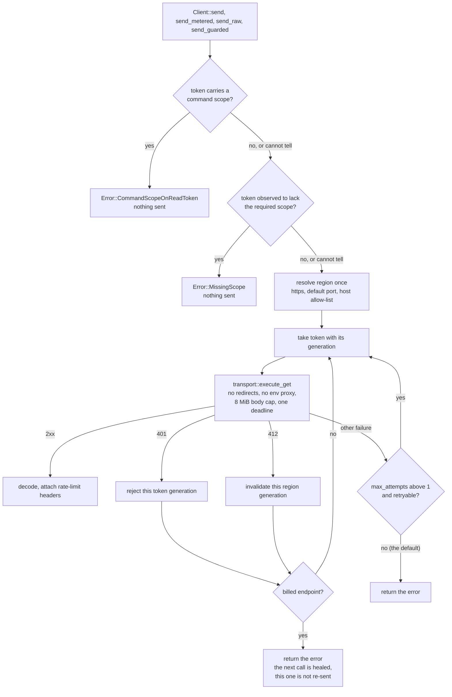

# Architecture

This document explains how the `fleetwire` crate is put together and why. It is written for a
reader who wants to judge the design in ten minutes; the rustdoc on each item carries the full
argument, including the alternatives that were rejected.

The design goal is narrow: **make the expensive and dangerous mistakes impossible or loud**. For
this API those mistakes are paying for a call twice, sending a token to the wrong host, holding a
token that can do more than read, and writing a secret into a log.

## Module map

| Module | Visibility | Responsibility |
|---|---|---|
| `endpoint`, `sealed` | public trait, private seal | `FleetGet`: what a request is. Sealed, so only this crate defines endpoints. |
| `api::vehicles`, `api::users` | public | The sixteen request types and their response models. |
| `pricing` | public | `Pricing` (what a request costs) and `Billing` (whether an outcome was charged). |
| `scope` | public | OAuth scopes and the expression an endpoint requires. |
| `client` | private, re-exported items | `Client`: scope pre-check, region resolution, the send loop, recovery, the guarded call. |
| `transport` | private | One HTTP GET round trip. Knows nothing about retries, regions or tokens. |
| `net` | private | The only place an HTTP agent is built; body reading under a size cap and a deadline; error stage classification. |
| `auth` | private, re-exported items | `TokenManager`: storage, rotation, single-flight refresh. `HttpRefresher`: the one POST. |
| `decode` | private | Envelope and body decoding shared by all endpoints. |
| `redaction` | private | The single layer that scrubs tokens, VINs and coordinates. |
| `error` | public | `Error`, with the retry and billing judgments as methods. |
| `clock` | private, re-exported trait | Time injection, so expiry logic is tested without sleeping. |

The layering runs in one direction: `client` → `transport` → `net`. `transport` cannot retry
because it knows nothing about retries, and `client` sends requests only through
`transport::execute_get`. That last part is convention plus review, not a wall: `client` holds the
agent, and the deny-list stops every method on it except `get`.

## A request, start to finish

Every public entry point goes through one private function, `send_inner`. The entry points differ
only in the shape of what they return (and `send_guarded` adds its free probe in front).
Everything that costs money or protects a token lives in `send_inner` once, so choosing a
different entry point cannot bypass it.

## Money

Tesla bills two of the sixteen endpoints. The crate treats cost as part of the type of a request,
then as a property of every outcome.

**Before the call.** `FleetGet::pricing()` reports `Pricing::Data { usd_per_request }` or
`Pricing::NotCharged`. It lives on the request type, so it cannot drift from the endpoint it
describes. `examples/pricing_table` prints the whole table from the types alone.

**During the call.** A billed request is sent **exactly once** by default.

- `max_attempts` defaults to `1`. Retrying is opt-in, and only `TransportNotSent` (provably never
  left the machine) and 500/502/503/504 are retryable.
- A 401 or a 412 on a billed endpoint is an answered request, and the crate counts an answered
  request as billed. The recovery still runs (the token generation is rejected, the region is
  re-resolved) so that the *next* call works, but the billed request is not re-sent.

That second rule has a history worth stating, because the first fix was wrong. The recovery paths
predate the billed endpoints and re-sent the request. The first correction skipped the whole
recovery for billed requests, which meant a caller that used only billed endpoints could never
heal: every call reused the stale token, got another 401, and was billed each time. Two
consecutive sends against a mock server measured exactly that. The rule was then narrowed to
"suppress the re-send and nothing else", and both halves are pinned by tests
(`a_401_on_a_paid_endpoint_is_not_re_fired` and its 412 twin check the request count *and* that
the following call succeeds).

**After the call.** `Error::billing()` answers `Billed`, `NotBilled` or `Unknown` for every
failure, from the request's pricing and how far the request got:

| Outcome on a billed endpoint | Judgment |
|---|---|
| Connection refused, connect or DNS timeout | `NotBilled` (never sent) |
| Failure after the request may have left | `Unknown` |
| Any answered status below 500, including the 408 of a sleeping car | `Billed` |
| 5xx | `NotBilled` |

This table is the crate's rule, not a statement of what Tesla invoices. What was measured is narrower: a
408 uses up a slot of the per-vehicle quota exactly as a successful call does. No row has been
reconciled against a Tesla usage statement, and the crate documentation tracks that as an open
item.

`net::classify` sorts transport errors into "not sent" and "unknown", and anything it does not
recognise is "unknown". A write failure on a pooled connection is "unknown" on purpose: it only
shows up on the next read, and calling it "not sent" would invite a retry that double-bills.

One more rule protects the accounting: when a 401 from the server is followed by a failure
inside the token layer, the caller gets the 401 back, not the token error. The token error would
describe a refusal by the server as "refresh suppressed" and, on a billed endpoint, would report
`NotBilled` for a call that was answered
(`a_suppressed_recovery_prefers_the_401_over_the_token_layer_error`).

**The guard.** `Client::send_guarded` asks the free `GET /api/1/vehicles/{vin}` for the car's
state and makes the billed call only when it is `online`. If the free probe fails, the billed call
is not made. The documentation is explicit that this narrows a time-of-check window and does not
close it: the car can fall asleep between the two calls.

## Tokens

`TokenManager` never touches the network; a `TokenRefresher` does the one POST. That split is why
the whole token layer is tested without a network.

- **Storage.** The token file is written `0600` in a `0700` directory, atomically (temp file,
  `fsync`, rename). Loading refuses a symlinked file, a symlinked directory and any permission
  wider than owner-only, and it checks permissions before it parses. Storing refuses a symlink at
  the token path or planted at the temp path, and leaves the symlink's target untouched.
- **Rotation is persisted first.** Tesla invalidates the old refresh token when it issues a new
  one. The new one is on disk before the new access token is returned to any caller
  (`the_rotated_refresh_token_is_persisted_before_the_new_access_token_is_returned`). If the write
  fails, this manager stops refreshing rather than continue with a token that exists only in
  memory.
- **Single-flight, twice.** Inside a process, concurrent callers collapse into one refresh and the
  rest are served from memory. Across processes, a file lock does the same. `flock` has no
  timeout, so the lock is taken with `try_lock`, backoff and a deadline.
- **Never retried.** A refresh that timed out may have succeeded on the server. Retrying it with
  the old refresh token would turn a possibly live chain into a certainly dead one.
- **Generations.** Each token handed out carries the generation of the cache it came from. A 401
  invalidates only the generation that was actually used, so a late 401 for an old token cannot
  discard a token another thread just refreshed. The rejected token's value is remembered, so the
  same bytes are never adopted from disk again.
- **Rotation storms.** A server-supplied lifetime above 30 days is clamped down. A lifetime below
  the 60-second expiry margin is *not* raised, because that would send a dead token; instead
  rotations are limited to one per 60 seconds, and a caller inside that window gets an error, not
  a stale token.

## Read-only

The crate's documentation is careful about what enforces this and what does not.

1. **The type system and visibility** are the real defence. `FleetGet` is sealed, every
   implementation in the crate issues a GET, and the only function that performs a request,
   `transport::execute_get`, is private and builds nothing else.
2. **A clippy deny-list** of every other `ureq` method and every other way to build an agent is a
   backstop. It makes the common accident loud. It does not stop a determined contributor, and
   the docs say so.
3. **A test guards the deny-list itself.** It strips TOML comments before checking, because an
   earlier version that searched the raw file kept passing when an entry was commented out.
4. **The one POST** in the crate is the token refresh, behind a single explicit `allow`.
   `scripts/check_invariants.py` fails CI if a second one appears.

## Where the token may go

A bearer token is only as safe as the hosts it is sent to.

- The client starts on a configured bootstrap host and asks Tesla which region the account is in.
  The answer is adopted only when it is `https`, has no userinfo, path, query or fragment, uses
  the default port, and names a host on the allow-list. A refused answer keeps the bootstrap host.
- The China host is left out of the default list because it has never been observed in a live
  response. A caller opts in with `ClientBuilder::allow_region_host`.
- Redirects are disabled on the one agent, and proxies from environment variables are ignored.
- The token refresh endpoint defaults to a constant. OIDC discovery is not followed, because the
  endpoint it advertises was measured to differ from the one where a refresh succeeds.
- These rules govern what a *server* can make the client adopt. The bootstrap host and the token
  URL are the caller's to configure (`ClientBuilder::bootstrap_region`,
  `HttpRefresher::with_token_url`); the tests and `offline_demo` use that to point at a mock.

## Secrets and personal data

`redaction` is the only place anything is scrubbed, so there is one policy to audit.

- JSON bodies go through a key allow-list first: a listed key's value is replaced whole, so a
  token with an unusual shape cannot slip past a pattern. String leaves then go through the text
  patterns as well.
- Opaque text goes through patterns for tokens, VINs, coordinates and account identifiers. One of
  those patterns exists because a live 412 body turned out to contain an account UUID.
- The two types that hold both an access and a refresh token write `Debug` by hand and
  destructure `self`, so adding a field without deciding how to print it is a compile error. One
  of them was found still deriving `Debug` during review, at the exact point where a single debug
  log line would have written a live refresh token.
- The type that holds a VIN and coordinates does not implement `Debug` at all.
- A VIN is checked when a request is built: one that could escape its path segment is refused
  before anything is sent.

## Evidence

The crate does not treat its own tests as proof that it matches Tesla. Its top-level
documentation keeps three lists: what was measured against the live API and when, what rests only
on documentation, and the open questions (O8 to O20) with the observation that would settle each.
Some examples of what the measurements changed:

- A 401 arrives in three shapes depending on which upstream rejected the request. One is an empty
  `text/html` body. All three map to one error variant instead of leaking as a decode failure.
- The 408 of a sleeping car has an `error_description` key that is present but empty, so the
  message fallback chain must skip empty strings.
- The free probe used by the guard returns no rate-limit headers. The docs call this
  "circumstantial evidence, not proof" that it is unbilled, and track the gap as O17.

## Testing

- **`fleetwire-testkit`** is a small mock HTTP server on std networking, with no async runtime,
  written for this crate. It can
  delay a response, trickle a body, or cut the connection after N bytes, which is what the
  deadline and billing-stage tests need.
- **Negative controls.** A test of a guard is trusted only after it has been seen to fail with the
  guard removed. Tests that could pass vacuously say so and assert their own precondition first.
- **Time is injected** through `Clock`, so token expiry and rotation intervals are tested without
  sleeping.
- **Request counts are asserted**, not just results. Most billing rules are statements about how
  many requests reached the server.
- **Fuzz targets** in `fuzz/` hand arbitrary bytes to the redaction layer, the response decoder,
  the scope check and the region URL check. The region target asserts the security property
  itself: whatever the input, an accepted URL is https, on the default port, without userinfo,
  and on an allow-listed host.

## Dependencies

Synchronous by choice: `ureq` with rustls, no async runtime. A blocking client is enough for a
metered API where the right number of concurrent billed calls is small, and it keeps the
dependency tree and the audit surface small. `cargo deny` checks advisories, licences, bans and
sources in CI. `unsafe` is forbidden across the workspace.
