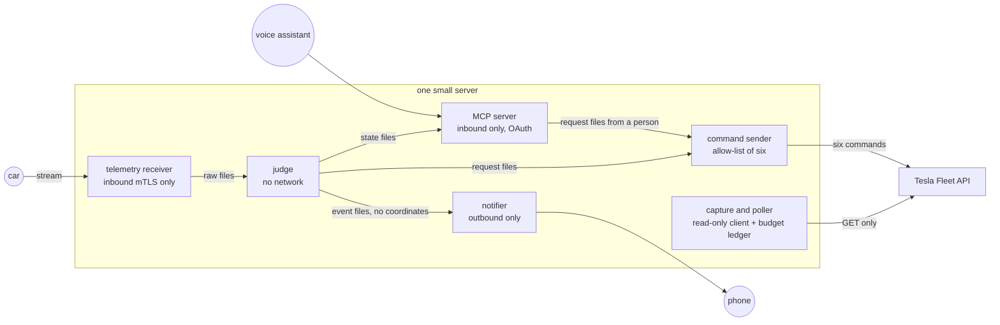

# Safety boundaries of the private workspace

The two crates in this repository, `fleetwire` and its test kit, are two of thirteen. The other
eleven are private: they receive a car's telemetry, judge it, notify a phone, answer a voice assistant through a
remote MCP server, and in six narrow cases send a command to the car. They are private because
they are built around one household's location data, not because the design is a secret.

This document describes that design: which boundaries the system keeps, and what makes each one
hold when the code is changed by an AI agent hundreds of times a month. It contains no code
from the private crates. Numbers are as of 2026-11-20.

## The shape of the system

The processes do not call each other. They communicate through files, and every shared file has
a named set of writers, usually exactly one. That choice is what makes the boundaries checkable:
a boundary is a statement about which crate may name which module, and a script can test that.

## The boundaries

| Boundary | Rule | What enforces it |
|---|---|---|
| **Commands** | Requests that change the car's state leave from one crate only, and only for the six names in its allow-list constant. | A gate scans every other crate for command paths, command names, command scopes and HTTP write methods, and scans the command crate for any command-shaped literal outside the list. Another gate fails if one of the other server crates depends on the command crate. |
| **Credentials** | The command sender has its own Tesla app, token and server account. The read client refuses a token whose claims show a command scope (an advisory check on unverified claims: a token it cannot read is not blocked). The command sender refuses a token whose scopes go beyond the four it needs. | Code in both clients, with tests; the read side is public in this repository (`CommandScopeOnReadToken`). |
| **Money** | Every billed call is reserved in a ledger before it is sent. Billed calls are never retried. | In the capture tool the reservation is a consuming token in the type system, and gates check that billed HTTP leaves from exactly one place there and that the poller has no retry opt-in. The command sender reserves its own paid reads and commands in its own ledger. |
| **Inbound** | Only three of the workspace's processes accept connections. Two of them must not depend on the Tesla client or on any HTTP client. | Dependency-tree gates (`cargo tree`), plus the sandbox below. |
| **Egress** | Every service account has a per-account outbound drop or a deny-all address rule, and every unit keeps a fixed set of sandbox directives. | A gate parses the unit and firewall files in the repository. A separate daily audit from another machine tests the live server by actually attempting connections. |
| **Coordinates** | Events, notifications, logs and tool answers carry names, times and numbers, not coordinates. The one tool that can state a position needs a server switch and a time-limited consent. Two things do carry coordinates by nature: a navigation command sends its destination to the car, and the operator's own analysis scripts read parking positions over SSH. | Gates restrict which files may read coordinate fields; writers refuse coordinate-like numbers and address-like names. |
| **Raw data** | On the server, raw telemetry is read by two subcommands of one binary. Everything else reads derived summaries. | A gate forbids the raw path and module names elsewhere. |
| **Single writer** | Each shared file is written through one module, under a lock, with a backup and a read-back check where loss would hurt. | One gate per file family (about half of the 67 gates are of this kind), plus a gate that forbids direct `rename`/`write` in product code. |
| **Unknown input** | A response key the policy table does not classify stops the capture with a distinct exit code. | The table is data; there is no per-caller bypass. |
| **Audit trail** | The navigation-card log and the vehicle ledger are hash-chained and append-only. | Two independent verifiers, one in Rust and one in Python, are kept in step by a gate. |

## Commands in more detail

The command sender is the part where a mistake is physical, so it has the most layers.

- **Allow-list.** Six commands: a navigation waypoint card, trunk open, two charging-preparation
  commands at one registered place, and adding or removing a preconditioning schedule. There is
  no code path for any other name. Climate-on, temperature, heater and defrost command names do
  not exist in the sending crates, and a gate checks that.
- **Caps.** 20 commands per day and 300 per month, with tighter per-kind caps (for example five
  trunk opens a day). It never wakes the car and never retries.
- **A person in the loop.** Navigation goes out as a card that the driver accepts on the car's
  screen. A trunk open starts from a person's spoken request. A schedule change is read back and
  confirmed with a single-use token that expires in two minutes. The one exception is charging
  preparation, the only physical command sent without a confirmation, and its conditions are
  narrow enough to list: a fresh park at one registered place, inside a measured bay, under a
  roof, unplugged, once per park, re-checked by the sender against a fresh reading before each
  command.
- **Fixed values.** The charging current the sender may set is a constant. No public function
  takes a value.
- **Separation from the internet.** The MCP server is reachable from outside and can only append
  a request line to a file. It never sends a request to Tesla. The sender is not reachable from
  outside and reads neither raw telemetry nor the live state file.
- **Unknown means no.** Where a judgment has three outcomes (yes, no, unknown), unknown takes the
  side that sends nothing. That rule came from real defects in which an unknown value was read
  as the permissive answer.

A residual-risk ledger, shaped after the claim, argument and evidence form of UL 4600, records
what the guards cannot stop (so far for four of the six commands), and gains a dated line every
time a command went out that a person did not want.

## Money in more detail

Tesla meters the API and there is no server-side idempotency key, so the design starts from what
cannot be guaranteed. The budget module's own documentation opens with a three-row table:

| Claim | Who guarantees it |
|---|---|
| At most one "sent" transition per reservation | The budget module, by its types and state machine |
| At most one HTTP request per reservation | Not the budget module. The send path proves it with request-counting tests against a mock server (the `not_re_fired` tests in this repository). |
| At most one charge on Tesla's side | Nobody can. A 408 is billed and there is no idempotency key. |

Collapsing those three rows into "we guarantee at-most-once" is treated as a defect in the
documentation. Amounts are integer micro-dollars, time is injected, and the ledger holds no
vehicle identifier.

## What a gate is

`check-wiring.sh` holds 67 gates. The commit hook refuses a commit that fails one, and the same
script runs in the completion check. (A clean merge does not run the commit hook, which is why
the completion check runs them again.)

- Gates are written as **absence** claims ("no file outside X names Y"), because a gate that
  counts occurrences of one message goes blind to everything it did not think to count.
- Exit code 1 means a violation and exit code 2 means the gate could not run. Without that
  split, a broken tool reads as "clean".
- Most gates scan source text and break when the code is refactored. That is intended: a human
  then decides whether the rule or the code should change.
- Checkers that have logic of their own carry a self-test, and one gate checks the harness
  itself: that every hook file exists and is executable, that every rule file still matches at
  least one path, and that no reviewer agent's definition lists an edit tool.

A smaller version of the same idea runs in this repository's CI:
[`scripts/check_invariants.py`](../scripts/check_invariants.py).

## What the gates do not prove

The gates are friction against mistakes, not a defence against an adversary. They read literals,
so a name assembled at run time passes. They check the repository, not the server, which is why
the live server is audited separately from another machine. And they check structure, not
judgment: whether an alert fires at the right moment is tested by replaying recorded data
through the old and the new binary and comparing the results, not by a gate.

The review standard for the workspace ranks findings by what the user would experience. A
coordinate leak, a command outside the allow-list and an unreserved paid call are at the top of
that list.
